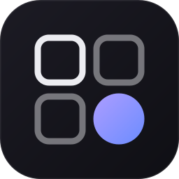
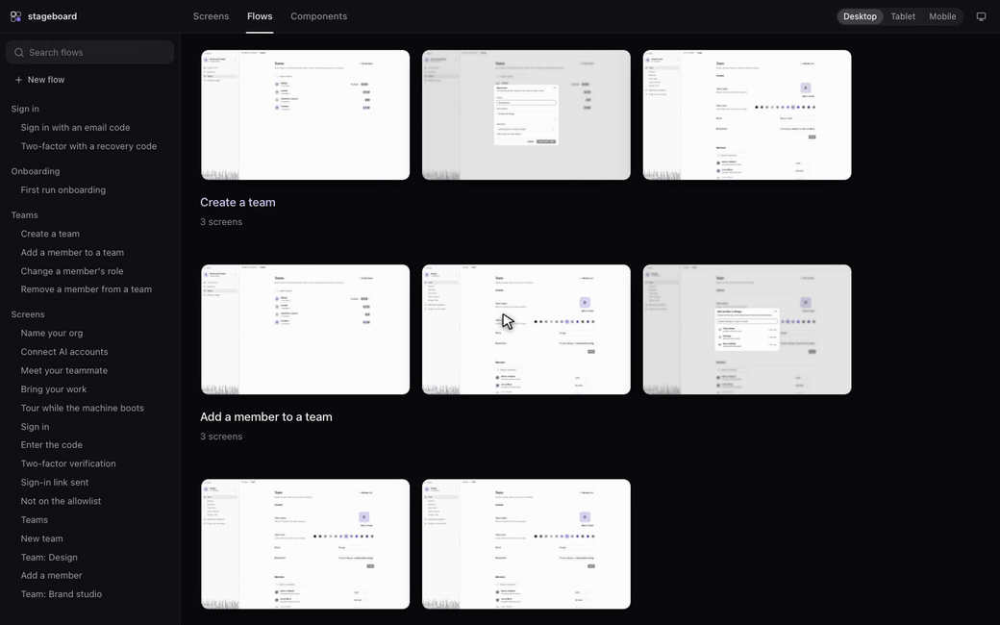
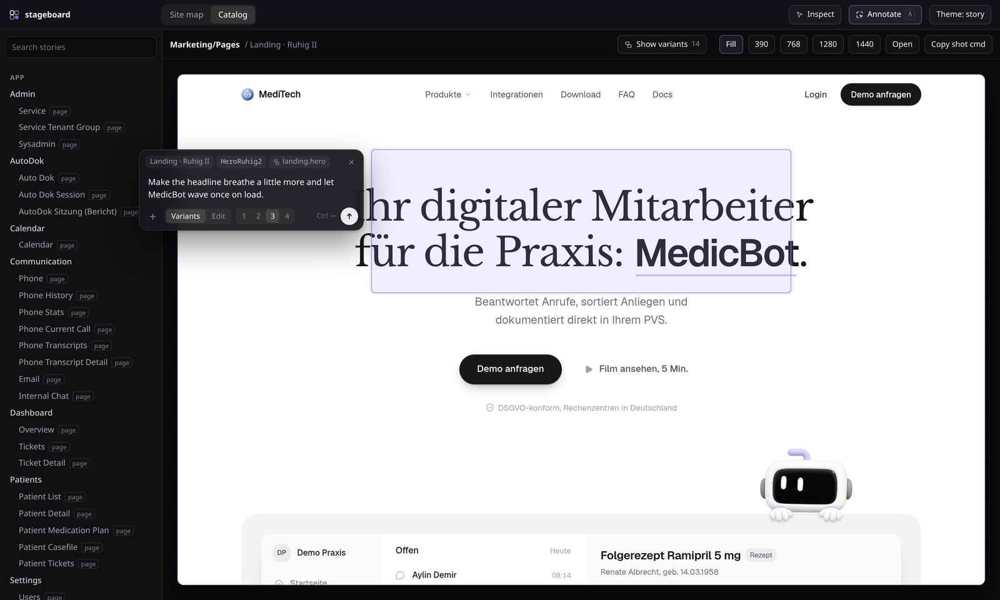

<p align="center">
  
</p>

<h1 align="center">stageboard</h1>

<p align="center">
  Your app's screens and flows on one board. Walk through a flow, mark what should change, and an agent changes the real code.
</p>

<p align="center">
  <a href="https://stageboard.design">stageboard.design</a> &nbsp; <a href="https://docs.stageboard.design">Docs</a>
</p>

<p align="center">
  
  
  
  
  
  
  
</p>

<p align="center">
  
  <br />
  <sub>A flow in <a href="https://atmos.build">atmOS</a>: open it, watch each screen play what the user does, note what should change as you go, then Reconcile sends every note to an agent at once.</sub>
</p>

## Get started: paste this into your agent

```text
Set up stageboard in this repo. Run `npm i -D stageboard` (use this repo's package manager), then
`npx stageboard skill` to install the stageboard skill, and follow it: write the config and a preview
with mock providers, add stories for the main components, put every page in Screens with realistic
mock data, and check each one with `npx stageboard shot`. Finish by listing the stories that look weak.
```

Works with Claude Code, Codex, atmOS or any agent that reads `.claude/skills` or `.agents/skills`.

## What it does

- **Flows.** Ordered journeys through your screens, like Mobbin's. Describe a new flow and an agent assembles it from existing screens, building the missing ones while they render as a pixel ocean; or add, drag and remove screens yourself. In the flow viewer each step says what is happening on the screen and plays what the user does on it (clicks, typing, key presses) with a cursor; Play runs the whole flow screen by screen. Annotate goes across screens: comment and sketch on one, press → for the next, and Note on flow becomes Reconcile, sending everything in one request. Click a screen (or press Enter) to use it, Escape to hand control back, R to replay it from the start. `npx stageboard flow shot <flow>` renders a whole flow into one grid image, playing each step's actions first and listing them with the note so an agent can take it in at once. Flows live in `stageboard/board.json`; commit it.
- **Stories with mock data.** A Storybook-compatible `*.stories.tsx` format. Pages are stories too, so no backend or login is needed.
- **Screens, Flows, Components.** Browse every page and the user flows through the app as Desktop, Tablet or Mobile, and every UI component in its own frame. The sidebar searches whichever you are looking at.
- **Components.** One row per component, its stories side by side. Each story renders in its own frame (`parameters.viewport`), fitted into the same 16:9 tile, so a small button is as easy to see as a whole panel. Open one to go through its stories with ← →, annotate them, and send one note on the whole component. `npx stageboard frames --write` measures every component story and sets frames that fit.
- **Annotate.** Press A. Comment is the default: drag over any screen, component, story or variant, write a note, paste reference images, and send it to an agent. On a single screen the same toolbar also lets you move, resize and retype elements, draw, add blocks and drop in your own components, then Reconcile. The agent gets every change plus before/after screenshots.
- **Live variants.** `variant("landing.hero", Hero)` makes a component swappable. Agents write `*.variant.tsx` files that appear while they work, and you pick one or keep the original. Adopt as original asks the agent to make the picked variant the new original. Production renders the original.
- **`stageboard shot`.** A headless screenshot of any story, variant or region. Agents use it to check their own work.
- **MCP server.** `list_stories`, `screenshot`, `flow_grid`, `list_variants`, `compare_variants`, `select_variant`, `list_flows`, `save_flow` and `complete_job` (agents report when they are done), attached to Claude and Codex agents automatically.

<p align="center">
  
  <br />
  <sub>A note on one screen of the Create a team flow in <a href="https://atmos.build">atmOS</a>, before it joins the others.</sub>
</p>

## Quick start

```bash
npm i -D stageboard
npx stageboard init        # writes stageboard.config.ts, with the preview at ./stageboard.preview.tsx
npx stageboard dev         # screens, flows, components and agent bridge on :6060/__stageboard/
```

```ts
// stageboard.config.ts
import { defineConfig } from "stageboard"
import { nextPreset } from "stageboard/next" // only for Next.js apps

export default defineConfig({
  stories: ["src/**/*.stories.tsx"],
  preview: "./stageboard.preview.tsx", // global CSS, providers, mocks
  vite: () => nextPreset({ root: __dirname }),
  agent: { provider: "claude" },
})
```

```tsx
// hero.stories.tsx
export default { title: "Marketing/Hero", component: Hero } satisfies Meta<typeof Hero>
export const Default: Story<typeof Hero> = { args: { title: "Hello" } }
export const Home: Story = { render: () => <HomePage />, parameters: { page: { route: "/", links: ["/pricing"] } } }
```

```tsx
// hero.calm.variant.tsx, written by you or by an agent
export const variant = { of: "landing.hero", label: "Calm", description: "Serif headline, ink button." }
export default function HeroCalm(props: HeroProps) { /* … */ }
```

To get the inspector bubble in your running app, render `<StageboardDevtools />` in development and proxy `/__stageboard/*` to the stageboard server.

## CLI

| command | |
|---|---|
| `stageboard init` | write a starter `stageboard.config.ts` |
| `stageboard dev [--port 6060] [--host 0.0.0.0]` | screens, flows, components, annotation bridge |
| `stageboard shot <story> [--variant id=key] [--width 1440] [--height 900] [--full] [--theme dark] [--scale 2] [--out file.png]` | PNG of a story, no app needed |
| `stageboard list [filter] [--json]` | story ids |
| `stageboard frames [filter] [--write]` | measure every component story and set a frame (`parameters.viewport`) that fits it |
| `stageboard flow shot <flow> [--device mobile] [--theme dark] [--cols 3] [--out file.png]` | every screen of a flow in one grid image, with its steps |
| `stageboard flow save '<json>'` | save a flow (JSON or a file path) to the running board |
| `stageboard done <job> [summary] [--failed]` | tell the running board an agent job is finished |
| `stageboard mcp` | MCP server on stdio |
| `stageboard skill [dir] [--claude] [--codex]` | install the agent skill into `.claude/skills` and `.agents/skills`, or only one |
| `stageboard variants` | regenerate the variants registry |

Every command takes `--config <file>` to use another config file.

## Agents

| provider | runs | shows up in |
|---|---|---|
| `claude` | `claude --bg`; `background: false` runs `claude -p` | `claude agents` |
| `codex` | `codex exec` | Codex |
| `atmos` | `atmos session new`, in the same worktree unless `sameWorktree: false` | atmOS sessions |
| `command` | any CLI; `{promptFile}` and `{jobId}` in the command, `$STAGEBOARD_PROMPT_FILE` and `$STAGEBOARD_JOB_ID` in its env | your tool |

With `detached: true` a `command` agent's job stays open until the agent calls `complete_job` or `stageboard done`.

Every request includes the marked region, a cropped screenshot, the component chain with source paths, your reference images and the variants in view. The prompt ends with a `Page context (JSON):` block, using the same convention as the atmOS browser extension.

## Docs

Guides and the full reference live at [docs.stageboard.design](https://docs.stageboard.design).

## License

MIT. Made by [atmOS](https://atmos.build), where stageboard is how we design and change our own app.
