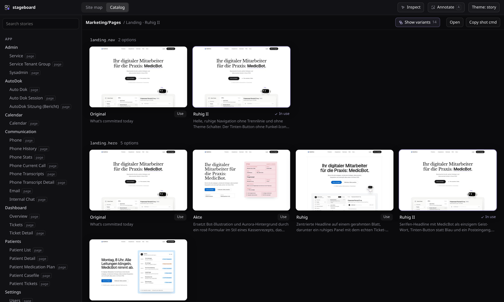

<p align="center">
  
</p>

<h1 align="center">stageboard</h1>

<p align="center">
  Your whole app on one board. Point at anything, ask an agent for variants, watch them appear live.
</p>

<p align="center">
  
  
  
  
  
  
  
</p>

<p align="center">
  
</p>

## Get started: paste this into your agent

```text
Set up stageboard in this repo. Run `npm i -D stageboard` (use this repo's package manager), then
`npx stageboard skill` to install the stageboard skill, and follow it: write the config and a preview
with mock providers, add stories for the main components, put every page on the site map with realistic
mock data, and check each one with `npx stageboard shot`. Finish by listing the stories that look weak.
```

Works with Claude Code, Codex, atmOS or any agent that reads `.claude/skills` or `.agents/skills`.

## What it does

- **Stories with mock data.** A Storybook-compatible `*.stories.tsx` format. Pages are stories too, so no backend or login is needed.
- **Site map.** Every page on a pan-and-zoom canvas with UX-flow edges, using cached thumbnails until you focus a page.
- **Annotate.** Drag over anything in the site map, a story or the variants gallery. Write a note, paste reference images, and send it to an agent.
- **Live variants.** `variant("landing.hero", Hero)` makes a component swappable. Agents write `*.variant.tsx` files that appear while they work, and you pick one or keep the original. Production renders the original.
- **`stageboard shot`.** A headless screenshot of any story, variant or region. Agents use it to check their own work.
- **MCP server.** `list_stories`, `screenshot`, `list_variants`, `compare_variants` and `select_variant`, attached to Claude and Codex agents automatically.

<p align="center">
  
</p>

## Quick start

```bash
npm i -D stageboard
npx stageboard init        # writes stageboard.config.ts
npx stageboard dev         # catalog, site map and agent bridge on :6060/__stageboard/
```

```ts
// stageboard.config.ts
import { defineConfig } from "stageboard"
import { nextPreset } from "stageboard/next" // only for Next.js apps

export default defineConfig({
  stories: ["src/**/*.stories.tsx"],
  preview: "./stageboard.preview.tsx", // global CSS, providers, mocks
  vite: () => nextPreset({ root: __dirname }),
  agent: { provider: "claude" },
})
```

```tsx
// hero.stories.tsx
export default { title: "Marketing/Hero", component: Hero } satisfies Meta<typeof Hero>
export const Default: Story<typeof Hero> = { args: { title: "Hello" } }
export const Home: Story = { render: () => <HomePage />, parameters: { page: { route: "/", links: ["/pricing"] } } }
```

```tsx
// hero.calm.variant.tsx, written by you or by an agent
export const variant = { of: "landing.hero", label: "Calm", description: "Serif headline, ink button." }
export default function HeroCalm(props: HeroProps) { /* … */ }
```

To get the inspector bubble in your running app, render `<StageboardDevtools />` in development and proxy `/__stageboard/*` to the stageboard server.

## CLI

| command | |
|---|---|
| `stageboard dev` | catalog, site map, annotation bridge |
| `stageboard shot <story> [--variant id=key] [--width 1440] [--full]` | PNG of a story, no app needed |
| `stageboard list [filter]` | story ids |
| `stageboard mcp` | MCP server on stdio |
| `stageboard skill` | install the agent skill into `.claude/skills` and `.agents/skills` |
| `stageboard variants` | regenerate the variants registry |

## Agents

| provider | runs | shows up in |
|---|---|---|
| `claude` | `claude --bg` | `claude agents` |
| `codex` | `codex exec` | Codex |
| `atmos` | `atmos session new`, in the same worktree | atmOS sessions |
| `command` | any CLI; the prompt is in `$STAGEBOARD_PROMPT_FILE` | your tool |

Every request includes the marked region, a cropped screenshot, the component chain with source paths, your reference images and the variants in view. The prompt ends with a `Page context (JSON):` block, using the same convention as the atmOS browser extension.

## License

MIT
